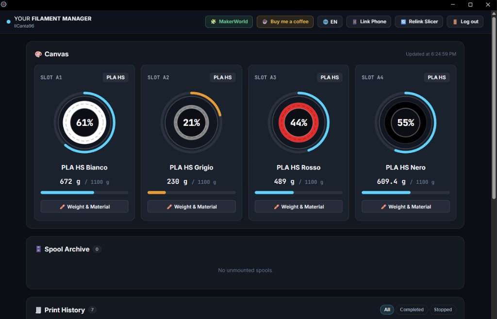

# Your Filament Manager

[](https://ko-fi.com/giuliocantarelli)
[](https://makerworld.com/it/@IlCanta96)
[](./LICENSE)

**Your Filament Manager** is an open-source, 100% free Windows desktop application (with an optional QR-locked mobile PWA via Cloudflare Workers) designed to automatically track filament consumption, manage the 4 spools mounted on your multi-color filament system, maintain your unmounted spool archive, and keep an accurate print history. Compatible with Centauri Carbon 2, Canvas, and Elegoo Cloud / Slicer accounts.

> **Original Author:** **Giulio Cantarelli**  
> **Buy me a coffee / Tip on Ko-fi:** [https://ko-fi.com/giuliocantarelli](https://ko-fi.com/giuliocantarelli) ☕  
> **3D Models & MakerWorld Profile:** [https://makerworld.com/it/@IlCanta96](https://makerworld.com/it/@IlCanta96) 🧩



---

## 🇬🇧 English Overview & Setup

### Key Features
- **100% Local & Private on Windows (`Your_Filament_Manager.exe`)**: Connects to your cloud account and reads your local **Elegoo Slicer** session automatically via Windows DPAPI — your password and token stay on your PC and your filament database (`data/filament_db.json`) is stored locally.
- **Automatic 4-Slot Spool Tracking**: Detects colors, materials, and slot assignments and deducts exact filament grams after every finished, stopped, or interrupted print.
- **Spool Archive & Print History**: Edit remaining grams, full spool weight, material, and colors, or inspect exact grams straight from local `.gcode` files.
- **QR-Code-Locked Mobile Web App (4G / 5G)**: Click **📱 Link Phone** on your Windows PC and scan the offline-generated QR code with your phone camera to open your synced dashboard anywhere as an installable PWA. Manual email/password login is disabled on the public Web App URL — access is only possible by scanning the QR code generated from your PC app.
- **Bilingual Interface**: Instant **English / Italian** language switcher (`🌐 EN` / `🌐 IT`).

### Quick Start (Windows PC)
1. Download the latest release `.zip` from **Releases** (or clone this repository) and extract all files into one folder on your Windows PC.
2. Double-click **`Your_Filament_Manager.exe`**.
3. Click **Launch Elegoo Slicer & Sign In** (or sign in using the Email & Password tab).

### Optional: Self-Host Mobile Web App (4G/5G) on Free Cloudflare Workers
1. Create a free [Cloudflare Workers](https://workers.cloudflare.com/) account.
2. Deploy `worker.js` and `./public` using `wrangler.toml`:
   ```bash
   npx wrangler deploy
   ```
3. Save your deployed `https://<your-worker>.workers.dev` URL in `data/cloud_url.txt` next to `Your_Filament_Manager.exe` (one line, no trailing slash). Opening **📱 Link Phone** in the PC app will automatically generate the QR code pointing to your private Cloudflare Web App.

---

## ☕ Support & 3D Models

If this project saves you time or filaments, you can support the author here:
- **Ko-fi Tips:** [https://ko-fi.com/giuliocantarelli](https://ko-fi.com/giuliocantarelli) (0% platform fee, goes straight to supporting new updates!)
- **MakerWorld Designs:** [https://makerworld.com/it/@IlCanta96](https://makerworld.com/it/@IlCanta96)

---

## 🇮🇹 Descrizione e Guida in Italiano

**Your Filament Manager** è un'applicazione desktop gratuita per Windows (+ Web App PWA opzionale su Cloudflare Workers) per tracciare automaticamente i grammi consumati, le 4 bobine caricate su Canvas, l'archivio delle bobine smontate e la cronologia delle stampe (compatibile con Centauri Carbon 2 / Elegoo Cloud e Slicer).

### Funzionalità principali
- **100% Locale su PC Windows (`Your_Filament_Manager.exe`)**: legge in locale la sessione di **Elegoo Slicer** (o tramite login diretto) senza inviare password all'esterno e salva i dati in `data/filament_db.json`.
- **Tracciamento automatico 4 Slot**: scala in automatico i grammi usati al termine (o all'arresto) di ogni stampa e legge i grammi esatti anche dai file `.gcode`.
- **Web App Mobile protetta da Codice QR (4G/5G)**: cliccando **📱 Collega Telefono** su PC puoi inquadrare il QR Code offline dallo smartphone per aprire la dashboard sincronizzata. Il login manuale dalla Web App è bloccato: si accede solo con il Codice QR del tuo PC.
- **Italiano / Inglese**: selettore istantaneo `🌐 IT` / `🌐 EN`.

### Avvio su PC e Web App Cloudflare personale
1. Scarica l'ultima release `.zip` dalla sezione **Releases** (o clona la repository) ed estrai `Your_Filament_Manager.exe` e la cartella `public/` nella stessa cartella.
2. Avvia **`Your_Filament_Manager.exe`**.
3. *(Opzionale per usare anche il telefono in 4G/5G)*: crea un account gratuito su [Cloudflare Workers](https://workers.cloudflare.com/), pubblica il worker con `npx wrangler deploy` e salva il tuo link `https://<tuo-worker>.workers.dev` dentro `data/cloud_url.txt` accanto a `Your_Filament_Manager.exe`.

---

## 📜 License & Attribution / Licenza e Attribuzione

Released under **GNU AGPLv3 + Commons Clause v1.0** (`Copyright (c) 2026 Giulio Cantarelli`) — see [LICENSE](./LICENSE).

- **Free for personal & community use:** You are free to use, study, fork, and improve this project.
- **Mandatory attribution:** You must keep all original copyright notices and credit **Giulio Cantarelli** in any copy, fork, modified release, or UI.
- **Share-alike:** Any modified or network-hosted version must keep its complete source code open under the same license.
- **No commercial selling:** Selling this software or offering paid subscriptions/services built on top of it is strictly prohibited.
